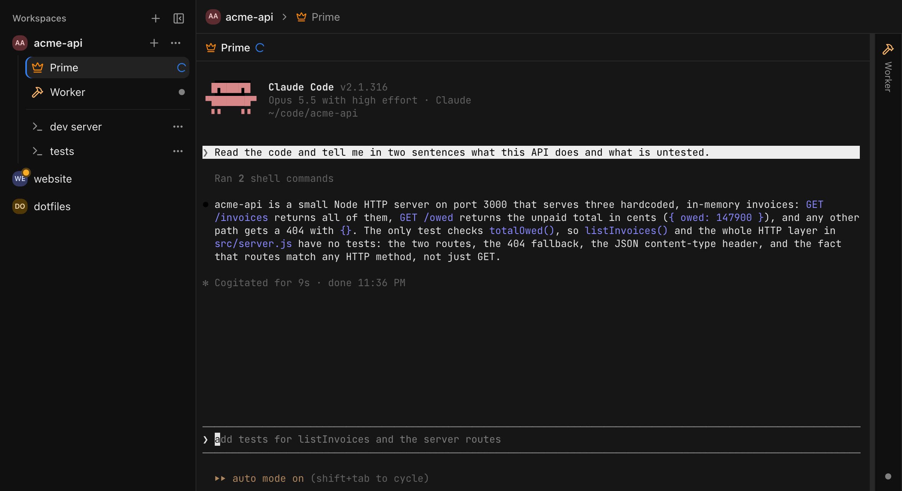
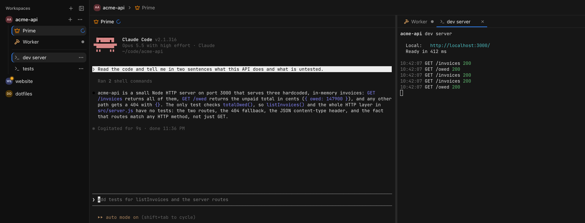

# k-bench

Persistent terminal Sessions on your Mac, organised into Workspaces, reachable from any browser on your tailnet. It launches Claude Code, and resumes it when you restart.



k-bench is macOS-only, and Tailscale is the only way in. It runs on your Mac as a background service and shows your terminals in a web page that only your own tailnet login can open.

## Why

You can reach Claude Code on your Mac from another device in a few ways, and each trades something away.

- **Claude Code's built-in remote mode.** [Remote Control](https://code.claude.com/docs/en/remote-control) shows a local Claude Code conversation in the Claude app or at claude.ai/code. It needs a claude.ai subscription (API keys are not supported), and some commands that only run in the terminal interface, such as `/plugin` and `/resume`, work only from the local terminal. You use Claude Code through a different interface from the one on your Mac.
- **Tools that wrap Claude Code in their own UI.** Tools in this category give you a purpose-built interface in place of the terminal. That can be easier to use on a phone, but the interface only shows what the tool chose to build: parts of Claude Code, such as the full TUI, your slash commands and hooks, can be missing or behave differently.

k-bench takes a third route. It gives you real Claude Code in a real terminal: persistent, and reachable from any browser on your tailnet. A Session runs your own login shell, or Claude Code itself, with your own PATH and config, so Claude Code, its slash commands, its hooks and everything you have set up behave as they do in your local terminal.

It is not only for Claude Code. **New shell** gives you a plain shell Session, so it works for any terminal workload: a dev server, a test watcher, a deploy, an editor.

## What you get

- **Sessions that keep running** when you close the browser tab, lock your phone or lose your connection. Come back from any Device and pick up where you left off.
- **A Workspace per project.** A Workspace points at a project folder on your Mac, and its Sessions start there.
- **A Prime and a Worker in every Workspace.** Two Claude Sessions that k-bench launches with fixed Launch options: the Prime plans in the left Pane, and the Worker builds in the right one. Opening the Workspace starts them, and a restart resumes each one's Claude conversation, even after a reboot or a `/clear`.
- **The Open Workspace follows you between Devices.** Open a Workspace on your laptop, and your phone shows it too.
- **Other Sessions in the right Pane's Tabs.** **New shell** for a dev server or a test watcher, or **New Claude…** to launch Claude Code with the model, effort, advisor and Focus view you choose.
- **Room when you need it.** Drag the divider to an edge to shut a Pane, and give the other one the whole width.
- **Bells.** When a Session rings the terminal bell, the sidebar marks it until you look at it.
- **A Phone layout** with a drawer for your Workspaces and Extra keys (Esc, Tab, Shift-Tab, Ctrl, the arrows and Enter) for the keys a phone keyboard lacks.
- **Access only for your tailnet login.** k-bench listens on localhost only and is published with `tailscale serve`. It admits only requests that carry your own tailnet login.



## Quick start

First get what [Setup](docs/guide/setup.md) says you need, and [set up Tailscale](docs/guide/setup.md#1-set-up-tailscale). Then:

```sh
npm i -g @k-electron/k-bench
k-bench install
```

`k-bench install` publishes k-bench on your tailnet and prints its URL. Open that URL from any device signed in to your tailnet with the same login. [Setup](docs/guide/setup.md) covers the install, updating and uninstalling. If something isn't working, run `k-bench status`.

## Guide

- [The guide](docs/guide/README.md): setup, using k-bench, using it with Claude Code, and troubleshooting.
- [CHANGELOG](CHANGELOG.md): what changed in each version.

## Security

k-bench is a remote shell: anyone who can open it can run commands on your Mac as you. It is built so that only you can. It listens on `127.0.0.1` only, `tailscale serve` is the only way in, and the server refuses any request that does not carry your own tailnet login, or that comes from a web page on another site. There is no password, no LAN mode and no other tunnel. [Access](docs/internals/access.md) has the details, and [SECURITY.md](SECURITY.md) says how to report a vulnerability privately.

## Contributing

Issues and pull requests are welcome. [CONTRIBUTING](CONTRIBUTING.md) covers setup, the checks and the pull request flow. [Internals](docs/internals/README.md) explains how k-bench works inside, [GLOSSARY.md](GLOSSARY.md) holds the vocabulary and [docs/adr/](docs/adr/) the design decisions.

## License

[MIT](LICENSE).
