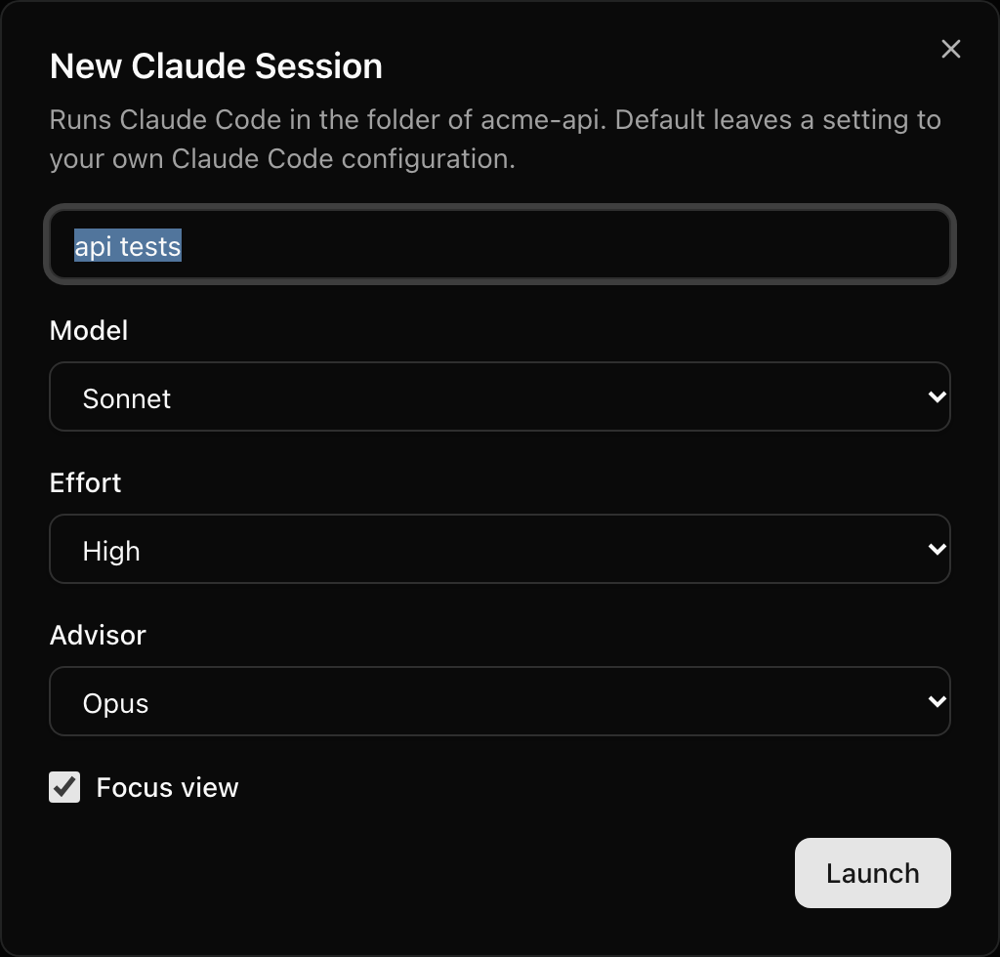
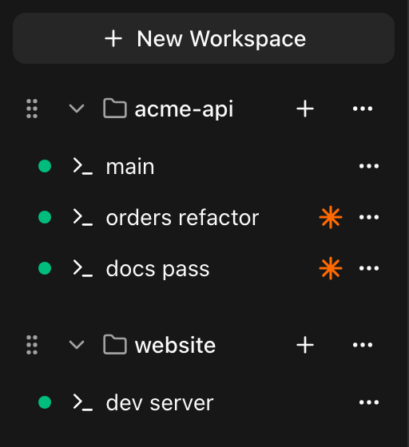

# Using k-bench with Claude Code

k-bench launches Claude Code for you and resumes it when you restart. A **Claude Session** is a Session that runs Claude Code itself, in a Workspace's folder, with the model, effort and advisor you pick in a dialog. Restarting it brings back the same Claude conversation. This page covers that, and the few things worth setting up so k-bench and Claude Code work well together.

k-bench only starts and resumes Claude Code, using its documented command-line flags. It never reads Claude Code's output or files. What you see in a Claude Session is the real Claude Code in a real terminal, so its slash commands, skills and hooks all work as they do on your Mac.

## Start a Claude Session

1. Create a [Workspace](using-k-bench.md#workspaces-and-sessions) for your project folder.
2. Choose the **+** next to the Workspace's name, then **New Claude…**.
3. Fill in the dialog (below) and choose **Launch**.



The new Session opens in the Focused Pane, so you can start typing to Claude at once. Claude Code starts in the Workspace's folder, through your own login shell, so your PATH, your `claude` install, your `~/.claude` settings and the account you are signed in to are the same as in a terminal window on that Mac.

The first time Claude Code runs in a folder it asks whether you trust it, and **"No, exit" is selected by default**. Answer in the terminal as you would anywhere. If you exit there, the Session stops, and you can restart it from its **...** menu.

### The dialog

| Field          | Choices                                                                                                                                                |
| -------------- | ------------------------------------------------------------------------------------------------------------------------------------------------------ |
| **Name**       | Optional. Blank gives "session 1", "session 2" and so on. A name already used in that Workspace is refused in the dialog, and your other choices stay. |
| **Model**      | Default, Fable, Opus, Sonnet, Haiku                                                                                                                    |
| **Effort**     | Default, Low, Medium, High, XHigh, Max                                                                                                                 |
| **Advisor**    | Default, Off, Fable, Opus, Sonnet                                                                                                                      |
| **Focus view** | A checkbox                                                                                                                                             |

- **Default** leaves that setting to your own Claude Code configuration, so your `~/.claude` settings still apply unless you choose something else.
- **Off** (for the advisor) turns the advisor off for this conversation, even when your settings turn it on.
- k-bench does not check which model can advise which. Claude Code does, when it starts: if it refuses a pairing, you see why (see [When Claude Code exits](#when-claude-code-exits)).

The dialog opens with the choices you launched with last time, on whichever device, because your Mac remembers them. The name is never remembered. Before your first Claude Session every choice is Default and Focus view is off.

The choices are fixed for the Session's life. To change the model or the view in the middle of a conversation, use Claude Code's own `/model` and `/focus`. A restart passes the original choices again.

### Focus view

Focus view is for small screens, where Claude Code's output is hard to follow. Claude Code starts in its condensed view: you see your prompt, a one-line summary of the work (such as "Edited 3 files +6 -3") and Claude's final response. The diffs and the narration between tool calls stay out of the way. Press **Ctrl-o** (on a phone, **Ctrl**, then `o`) to see everything.

Focus view applies to that launch only. k-bench does not change your Claude Code settings, so terminals outside k-bench are not affected. Claude Code runs full-screen in a Focus view Session and keeps its own scrollback, so k-bench's [History](using-k-bench.md#scrolling-selecting-and-copying) stays empty while it runs.

## The Claude glyph



A Claude Session shows a small orange glyph beside its name in the sidebar, and its accessible name is "_name_ is a Claude Session". Only Claude Sessions have it.

## Quitting, errors and restarting

### When Claude Code exits

When you quit Claude Code (for example with `/exit`), the Session becomes [Stopped](using-k-bench.md#stopped-sessions-logging-out-and-restarting) straight away. There is no shell underneath a Claude Session, so there is no prompt to fall back to.

If Claude Code exits with an error, such as a model and advisor it won't pair, or a `claude` that isn't installed, the Session keeps the error on screen. It shows "Claude Code exited with an error. Press any key to close." and stays running until you press a key, then it is Stopped. That way a bad choice never looks like nothing happened.

### Restarting resumes the conversation

A Stopped Claude Session is restarted like any other: open its **...** menu and choose **Restart**. There is no dialog. Claude Code resumes the same conversation, with the same model, effort, advisor and Focus view the Session was launched with. That includes after you log out of your Mac or restart it, so you do not need Claude Code's `/resume`, and you cannot pick the wrong conversation when several share a folder.

Claude Code saves a conversation only after you send your first message. If you quit before sending one, there is nothing to resume, so the restart starts a fresh conversation with the same choices.

Deleting a Claude Session ends it but leaves its conversation alone, so you can still find it with `claude --resume` in a terminal.

## Typing `claude` in an ordinary Session

An ordinary Session, from **New shell**, is a shell. If you type `claude` in it, that is still just a program in a shell: k-bench does not notice it, so the Session gets no glyph and no resume. After a logout or a restart you get a fresh shell and bring the conversation back with Claude Code's own `/resume`. Use **New Claude…** when you want k-bench to launch and resume Claude Code for you.

## Two things that can surprise you

- **`CLAUDE_CODE_EFFORT_LEVEL`.** If you export it in your shell setup, Claude Code uses it instead of the Effort you choose in the dialog. That is Claude Code's own rule, and k-bench does not work around it. Choose Default, or unset the variable, if you want the dialog to decide.
- **The trust prompt.** As above, its default is "No, exit", so pressing Enter on it ends the Session.

## Make Claude Code ring the Bell when it is waiting

k-bench raises a [Bell](using-k-bench.md#bells) when a Session's shell rings the terminal bell, and that works in a Claude Session as in any Session. Claude Code can ring the terminal bell when a task finishes or it is waiting for you on a permission prompt. Turn that on, and a Bell shows on that Session in the sidebar.

Add this to `~/.claude/settings.json` on the Host (merging it with any settings already in the file):

```json
{
  "preferredNotifChannel": "terminal_bell"
}
```

The setting is called `preferredNotifChannel`, and `"terminal_bell"` makes Claude Code ring the bell character in any terminal. You can also set it from inside Claude Code: run `/config` and change **Local notifications**. With the default (`"auto"`), Claude Code sends a desktop notification in a few terminals and does nothing in most others, so set it explicitly for k-bench.

Sources, from Claude Code's current documentation:

- [`preferredNotifChannel` in the settings reference](https://code.claude.com/docs/en/settings-reference#preferrednotifchannel), which lists its values and where it applies.
- [Get a terminal bell or notification](https://code.claude.com/docs/en/terminal-config#get-a-terminal-bell-or-notification), which says when Claude Code sends the notification: when it finishes a task or pauses for a permission prompt, and you appear to be away from the terminal.

To check it, start a short task in a Session, then open a different Session. When Claude Code finishes, the first Session shows a Bell. Remember that a Session only raises a Bell while nothing is viewing it, so a tab left open on that Session elsewhere hides it. See [Troubleshooting](troubleshooting.md#a-session-never-shows-a-bell).

## One Session per Claude conversation

A Claude Session is tied to the one conversation it started with, so give each Claude conversation its own Claude Session, and name it after the task (in the dialog, or later with **...** then **Rename**). Then:

- you can run several conversations at once and switch between them from the sidebar;
- a Bell tells you which one is waiting, instead of you checking each in turn;
- a conversation carries on in its Session when you close the tab or lose your connection;
- a restart brings back the right conversation, even when several share a folder.

Several Sessions can share one Workspace, and several Workspaces can point at the same folder. If two conversations will edit the same project at once, they can step on each other's files. A common remedy is a separate git worktree for each, with a Workspace per worktree.

## A second Pane for a dev server

On a wide screen, put Claude Code in one [Pane](using-k-bench.md#panes) and a dev server, a test watcher or a log tail in the other. Create a shell Session in the same Workspace for it (**+**, then **New shell**), open it with `⌘`-click (or **Open in other pane**), and use `⌘\` to move between the two. You see Claude's changes take effect as they happen.

## Driving Claude Code from your phone

The dialog works in the phone layout, so you can launch Claude Code from anywhere. Once it is running, the [extra keys](using-k-bench.md#the-phone-layout) cover the keys Claude Code uses that a phone keyboard lacks. [Claude Code's keyboard shortcuts](https://code.claude.com/docs/en/interactive-mode) list them all. The ones you will reach for:

| Key                        | What it does in Claude Code                                                                                                                                                                          |
| -------------------------- | ---------------------------------------------------------------------------------------------------------------------------------------------------------------------------------------------------- |
| **Esc**                    | Interrupts Claude mid-response so you can redirect it, closes a dialog, and declines a permission prompt. Tap it twice, quickly, to clear your draft or, with an empty prompt, open the rewind menu. |
| **⇧Tab**                   | Cycles Claude Code's permission modes.                                                                                                                                                               |
| **Ctrl**, then `c`         | Interrupts a running operation (Ctrl is one-shot: tap it, then press `c`). With nothing running, the first press clears your prompt and a second one exits Claude Code, so don't repeat it by habit. |
| **Ctrl**, then `o`         | In a Focus view Session, shows everything Claude Code is hiding.                                                                                                                                     |
| **Tab** and the arrow keys | Tab accepts an autocomplete suggestion. The arrow keys move through menus and your prompt history.                                                                                                   |

Next: [Troubleshooting](troubleshooting.md).
