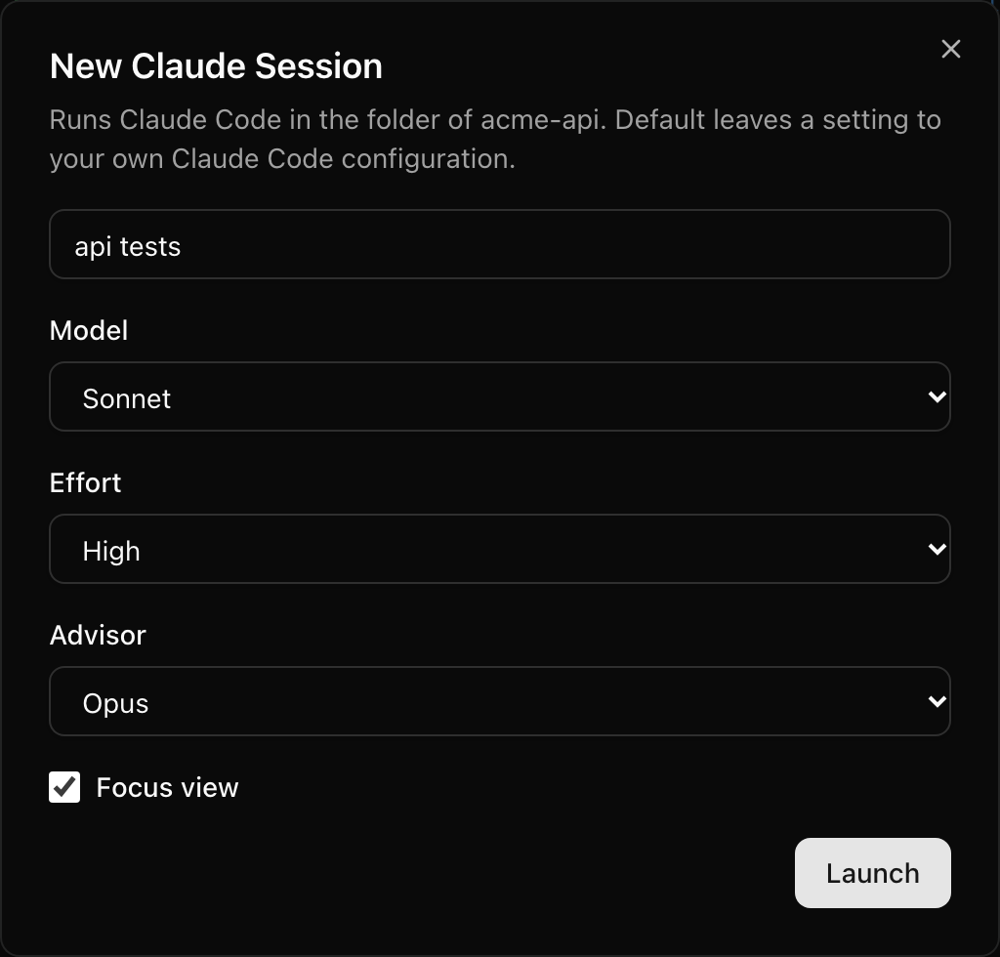
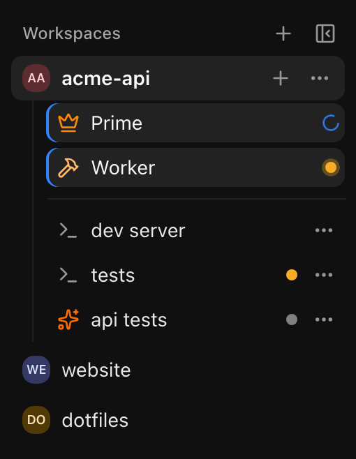

# Using k-bench with Claude Code

k-bench launches Claude Code for you and resumes it when you restart. Every Workspace comes with two Claude Sessions, the Prime and the Worker, and you can launch more from the New Claude dialog.

k-bench starts and resumes Claude Code with its documented command-line flags, and adds silent hooks so it knows which Claude conversation a Session is in (see [Restarting resumes the conversation](#restarting-resumes-the-conversation)) and [what it is doing](#see-what-a-claude-session-is-doing), and starts it in [the dark theme](#claude-sessions-use-the-dark-theme). It changes nothing else. A Claude Session is the real Claude Code in a real terminal, started in the Workspace's folder through your own login shell, so your PATH, your `claude` install, your `~/.claude` settings, slash commands, skills and hooks are the same as in a terminal on your Mac.

## The Prime plans and the Worker builds

Each Workspace's [Prime and Worker](using-k-bench.md#the-prime-and-the-worker) are launched and resumed by k-bench with fixed Launch options:

- **The Prime**, in the left Pane, runs Opus at high effort with the advisor off. Use it to think through the work and plan it.
- **The Worker**, in the right Pane, runs Sonnet at high effort with an Opus advisor. Hand it the plan to carry out.

Both run in [Focus view](#focus-view). You don't choose their Launch options, and k-bench passes them again on every launch. When they start and stop is in [The Prime and the Worker](using-k-bench.md#the-prime-and-the-worker).

## Other Sessions

Use [Other Sessions](using-k-bench.md#other-sessions) for whatever runs beside the Prime and Worker. They open in the right Pane, each with its own Tab, so you can switch between the Worker and them.

- **A dev server, a test watcher or a log tail**: choose **+**, then **New shell**, and start it there. Choose the Worker's Tab to go back to it, and the shell's Tab to see Claude's changes take effect.
- **A side conversation**: choose **+**, then **New Claude…**, to ask something without disturbing the Prime or the Worker.

A Claude Session runs one Claude conversation at a time. You can move it to another with `/clear` or `/resume`, but a separate Claude Session per piece of work keeps each one's Bell and resume apart.

## Start a Claude Session

Choose the **+** next to the Open Workspace's name, then **New Claude…**, fill in the dialog and choose **Launch**. The new Session opens in the right Pane.



| Field            | Choices                                                                                                                                  |
| ---------------- | ---------------------------------------------------------------------------------------------------------------------------------------- |
| **Session name** | Optional. Blank gives "session 1", "session 2" and so on. A name already used in that Workspace is refused, and your other choices stay. |
| **Model**        | Default, Fable, Opus, Sonnet, Haiku                                                                                                      |
| **Effort**       | Default, Low, Medium, High, XHigh, Max                                                                                                   |
| **Advisor**      | Default, Off, Fable, Opus, Sonnet                                                                                                        |
| **Focus view**   | A switch                                                                                                                                 |

The Model, Effort, Advisor and Focus view are the Session's **Launch options**.

- **Default** passes nothing, so your own Claude Code settings decide.
- **Off**, for the advisor, turns the advisor off for this Claude conversation even when your settings turn it on.
- k-bench doesn't check which model can advise which. Claude Code does when it starts, and if it refuses a pairing you see why (see [When Claude Code exits](#when-claude-code-exits)).

The dialog opens with the Launch options you last used, on any Device, because your Mac remembers them. The name is never remembered.

Launch options are fixed for the Session's life, and a restart passes them again. To change the model or the view mid-conversation, use Claude Code's own `/model` and `/focus`.

### Focus view

Focus view suits small screens. Claude Code starts in its condensed view: your prompt, a one-line summary of the work (such as "Edited 3 files +6 -3") and Claude's final response. Press **Ctrl-o** (in the Phone layout, **Ctrl**, then `o`) to see everything.

It applies to that launch only, and doesn't change your Claude Code settings. Claude Code then draws its own full screen, so k-bench's [History](using-k-bench.md#history-scrolling-and-copying) stays empty while it runs.

## Claude Sessions use the dark theme

Every Claude Session k-bench starts, the Prime and the Worker included, uses Claude Code's dark theme, on every start and restart. k-bench's terminal is dark, and Claude Code's light theme colours some text near-black, such as the heading of a question it asks you. The theme applies to that launch only, like [Focus view](#focus-view), so your own Claude Code theme setting stays as you set it, for Claude Code outside k-bench.

Choosing a theme with `/theme` inside a Claude Session saves it to your Claude Code settings, so it changes the theme for Claude Code everywhere. That Session goes back to the dark theme when it restarts.

## Quitting, errors and restarting

### When Claude Code exits

When you quit Claude Code (with `/exit`, say), the Session is [Stopped](using-k-bench.md#stopped-sessions) at once. There is no shell underneath a Claude Session to fall back to.

If Claude Code exits with an error, such as a model and advisor it won't pair, or a `claude` that isn't installed, the Session keeps the error on screen: "Claude Code exited with an error. Press any key to close." It is Stopped once you press a key, so a bad choice never looks like nothing happened.

For when a Prime or Worker that exits starts again, see [The Prime and the Worker](using-k-bench.md#the-prime-and-the-worker).

### Restarting resumes the conversation

[Restarting](using-k-bench.md#stopped-sessions) a Stopped Claude Session opens no dialog. Claude Code resumes the Claude conversation last running in the Session, with the same Launch options, even after a logout or a Mac restart, so you don't need `/resume`. k-bench knows the conversation by its ID, so it can't pick the wrong one when several share a folder.

A Claude Session follows its conversation. When you move to another one inside Claude Code, with `/clear`, `/resume`, `/branch` or `/fork`, k-bench saves it at once, whether or not a browser is open, and a later restart resumes that one. Compacting keeps the same conversation. k-bench does this with a `SessionStart` hook it adds to each Claude Code it launches, for that launch only. The hook prints nothing, and your own settings and hooks are left alone.

It can't follow a move when Claude Code doesn't run hooks: in a folder you haven't trusted, or when your settings have `disableAllHooks`. A restart then resumes the last conversation k-bench knew.

Claude Code saves a conversation only after your first message. If you quit before sending one, including after a `/clear`, the restart starts a fresh conversation with the same ID and Launch options.

Deleting a Claude Session leaves its conversation alone, so `claude --resume` in a terminal still finds it.

## See what a Claude Session is doing

Each Claude Session shows whether it is **Working**, in a turn, **Waiting**, stopped to ask you something (a permission prompt, a question or a plan to approve), or **Idle**, its turn over and nothing asked of you. The state is kept on your Mac, so every Device shows the same, and it changes live. A Session shows one marker, the most urgent: Waiting, then its [Bell](using-k-bench.md#bells), then Working or Idle. Viewing the Session clears the Bell but not Waiting, which lasts until you answer: any key you send that Session counts as an answer, but scrolling it doesn't. While a Workspace isn't open, its tile pulses if any of its Sessions is Waiting, ahead of a Bell's dot, and so does the dot on the phone's menu button for the other Workspaces. Shells and Stopped Sessions have no state, and Working and Idle never show on a Workspace's tile.



k-bench learns the state from hooks it adds to each Claude Code it launches, alongside the conversation hook, and like it they print nothing. Where Claude Code doesn't run hooks (an untrusted folder, or `disableAllHooks`), the Session always shows Idle, and so does one started by an older k-bench until you restart it. Claude Code reports nothing when you press Esc to interrupt a turn, so the Session shows Working until it has printed nothing for about 15 seconds, then Idle. A background subagent that asks for a permission Claude Code can't show you may leave its Session Waiting until you send it a key or the turn moves on.

## Typing `claude` in an ordinary Session

A **New shell** Session is a shell. If you type `claude` in it, k-bench doesn't notice: the Session gets no sparkle and no resume. After a logout or a restart you get a fresh shell, and bring the conversation back with Claude Code's own `/resume`. Use **New Claude…** when you want k-bench to launch and resume Claude Code for you.

## Two things that can surprise you

- **`CLAUDE_CODE_EFFORT_LEVEL`.** If your shell setup exports it, Claude Code uses it instead of the Effort in the Launch options, the Prime's and Worker's included. That is Claude Code's own rule. Unset it if you want the Launch options to decide.
- **The trust prompt.** The first time Claude Code runs in a folder it asks whether you trust it, and **"No, exit" is selected by default**, so pressing Enter ends the Session. Restart it and answer the other way.

## Make Claude Code ring the Bell when it is waiting

Claude Code can ring the terminal bell when it finishes a task or waits on a permission prompt, and k-bench shows that as a [Bell](using-k-bench.md#bells) on the Session. Add this to `~/.claude/settings.json` on the Host, merging it with what is there:

```json
{
  "preferredNotifChannel": "terminal_bell"
}
```

You can also set it from inside Claude Code: run `/config` and change **Local notifications**. With the default, `"auto"`, Claude Code rings nothing in most terminals, so set it explicitly. Claude Code's documentation covers [the setting](https://code.claude.com/docs/en/settings-reference#preferrednotifchannel) and [when it notifies](https://code.claude.com/docs/en/terminal-config#get-a-terminal-bell-or-notification).

To check it, start a short task in the Worker, then open an Other Session in the right Pane. When Claude Code finishes, the Worker's Tab shows a Bell. If it doesn't, see [Troubleshooting](troubleshooting.md#a-session-never-shows-a-bell).

## Driving Claude Code from your phone

The New Claude dialog works in the Phone layout, and the [Extra keys](using-k-bench.md#the-phone-layout) cover the keys Claude Code uses that a phone keyboard lacks. [Claude Code's keyboard shortcuts](https://code.claude.com/docs/en/interactive-mode) list them all. The ones you will reach for:

| Key                        | What it does in Claude Code                                                                                                                                                                          |
| -------------------------- | ---------------------------------------------------------------------------------------------------------------------------------------------------------------------------------------------------- |
| **⎋** (Esc)                | Interrupts Claude mid-response so you can redirect it, closes a dialog, and declines a permission prompt. Tap it twice, quickly, to clear your draft or, with an empty prompt, open the rewind menu. |
| **⇤** (Shift-Tab)          | Cycles Claude Code's permission modes.                                                                                                                                                               |
| **Ctrl**, then `c`         | Interrupts a running operation. With nothing running, the first press clears your prompt and a second one exits Claude Code, so don't repeat it by habit.                                            |
| **Ctrl**, then `o`         | In Focus view, shows everything Claude Code is hiding.                                                                                                                                               |
| **⇥** (Tab) and the arrows | Tab accepts an autocomplete suggestion. The arrows move through menus and your prompt history.                                                                                                       |

Next: [Troubleshooting](troubleshooting.md).
