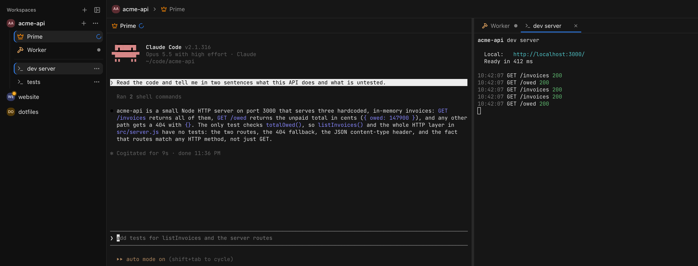
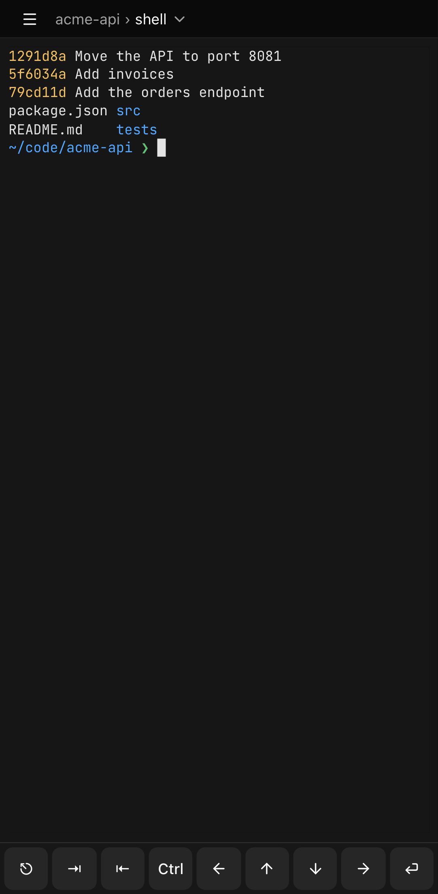

# Using k-bench

Open the URL that `k-bench install` printed. The sidebar lists your Workspaces, and the main view shows the Open Workspace: its Prime in the left Pane and its Worker in the right one. The words in this page are defined in [GLOSSARY.md](../../GLOSSARY.md).

## Workspaces

A Workspace points at one project folder on your Mac, and every Session in it starts in that folder. A folder has at most one Workspace, so a project never gets two Primes and two Workers editing the same files. Choosing a folder that already has a Workspace takes you to that Workspace instead of making a second one.

**New Workspace** opens a folder picker. **Places** on its left jumps to Home, to the folders that already hold your Workspaces, or to Computer, the top of the disk. You can also type or paste a path into the bar above the list, and make new folders for a new project: nothing is made on disk until you choose **Create**.

Creating a Workspace makes its Prime and Worker with it, both Stopped until you open it. The Workspace's name defaults to the folder's name. **Change folder** in the Workspace's **...** menu uses the same picker. Deleting a Workspace ends all its Sessions, and never touches the folder on disk.

The sidebar marks each Session with an icon: a crown for the Prime, a hammer for the Worker, a sparkle for another Claude Session and `>_` for a shell. A Stopped Session is dimmed.

### Missing

A Workspace is Missing when its folder no longer exists, because you moved, renamed or deleted it. Its tile shows a warning mark. Sessions already running in it carry on, but none can start or restart there, and the attempt says "Folder does not exist". Every other Workspace keeps working.

To fix it, open the Workspace and choose **Change folder**, from the note under its name, its **...** menu or the Pane, and point it at the folder's new place. Its Prime and Worker then start there. If you put the folder back where it was, the mark goes away by itself.

## The Prime and the Worker

Every Workspace has exactly one Prime and one Worker. They are Claude Sessions that k-bench makes with the Workspace, and they last as long as it does. They can't be renamed or deleted, and no Other Session can take their names.

k-bench sets their Launch options, and passes them again on every launch:

| Session    | Model  | Effort | Advisor | Focus view |
| ---------- | ------ | ------ | ------- | ---------- |
| **Prime**  | Opus   | High   | Off     | On         |
| **Worker** | Sonnet | High   | Opus    | On         |

The Prime is for planning and the Worker for building. [Using k-bench with Claude Code](claude-code.md) covers how to work with them.

**Opening a Workspace starts them.** That means choosing its name in the sidebar, or loading k-bench in a browser while it is the Open Workspace. A Stopped Prime or Worker starts then, resuming its Claude conversation, and one that is running is left alone. A reconnect doesn't count as opening.

k-bench never restarts one by itself. If you quit one or it crashes, it stays Stopped until you open the Workspace again or choose **Restart**.

## The Open Workspace

The Open Workspace is kept on your Mac, so it follows you between Devices. Open a Workspace on your laptop and your phone switches to it too. Before you have opened any, it is the first Workspace in your order. Deleting it makes the first Workspace the Open Workspace, without starting its Sessions.

No Pane ever shows a Session from another Workspace. To work on another project, open its Workspace.

## Other Sessions

The **+** next to the Open Workspace's name makes an Other Session, which opens in the right Pane and starts in the Workspace's folder:

- **New shell** starts your login shell. Use it for a dev server, a test watcher or anything else.
- **New Claude…** opens a dialog for a name and the Launch options, then launches Claude Code. See [Using k-bench with Claude Code](claude-code.md#start-a-claude-session).

A Session left unnamed is called "session 1", "session 2" and so on. You rename, reorder and delete Other Sessions from the sidebar; dragging reorders them, and the Prime and Worker always stay at the top. Deleting a Session ends its program and everything running in it. Deleting a Claude Session leaves its Claude conversation alone.

A Session is a program on your Mac, not a page in your browser. Closing the browser tab, locking your phone or losing your connection leaves it running, and the page reconnects on its own. You can view one Session on several Devices at once; the terminal then takes the size of the Device you used most recently.

## Panes, Tabs and Rails

Outside the Phone layout the main view has two Panes. The left Pane always shows the Prime. The right Pane shows the Worker, or an Other Session you opened there.

Each Other Session you open in the right Pane gets a Tab, after the Worker's, which always comes first. Removing a Tab leaves its Session running, and you can open it again from the sidebar. Choosing the Workspace's name brings back the Prime and the Worker, and keeps the Tabs.

Drag the divider between the Panes to resize them. Drag it to an edge to shut that Pane: it becomes a Rail, a thin strip naming its Session. Choose the Rail, or open something into that Pane, to bring it back.

## What is kept where

Most of what you choose is kept on your Mac, the Host, and every Device shows it the same. A few layout choices are kept by each Device, so a laptop and a phone can each be set up their own way.

| On the Host, shared by every Device                       | On each Device                                             |
| --------------------------------------------------------- | ---------------------------------------------------------- |
| Workspaces and their order                                | Each Workspace's divider, and which Pane is shut           |
| Each Workspace's Sessions and their order                 | Whether the sidebar is collapsed                           |
| The Open Workspace                                        | The Session the Phone layout last showed in each Workspace |
| Each Workspace's right Pane: its Tabs and which one shows | Smart typing, on or off for each Session                   |
| The Launch options last used in the New Claude dialog     |                                                            |

Anything kept on the Host survives a restart of k-bench, a logout and a restart of the Mac. Anything kept on a Device lives in that browser's storage, and survives a reload.

## Stopped Sessions

A Session is Stopped when its program no longer exists: it exited, or you logged out of your Mac or restarted it, which ends every program you were running.

- **Logout or restart.** k-bench comes back on its own when you log in again, with every Workspace and Session still listed, all Stopped. Opening a Workspace starts its Prime and Worker. Restart any Other Session from its **...** menu, or with the **Restart** button its Pane shows.
- **What a restart starts.** A shell Session gets a fresh shell in the same folder, so a dev server needs starting again. A Claude Session resumes its Claude conversation with its Launch options, as [Restarting resumes the conversation](claude-code.md#restarting-resumes-the-conversation) explains.
- **Updating k-bench** stops no Session. See [Updating](setup.md#3-updating).

k-bench starts when you log in to the Mac, not when it boots to the login window, and the Mac has to be on and awake for you to reach it.

## Bells

A Session raises a Bell when its program rings the terminal bell, for example `printf '\a'`. The Session shows a bell icon in the sidebar, and its Workspace's tile shows an amber dot while that Workspace isn't open. A Tab or Rail whose Session has a Bell shows a dot too. The Bell clears when you view that Session.

A Bell is a mark on the page. It makes no sound and sends no push notification. It survives a k-bench restart, and is lost only with the Session's program, after a logout or a Mac restart.

If a Bell never shows, see [Troubleshooting](troubleshooting.md#a-session-never-shows-a-bell). To make Claude Code ring it, see [Using k-bench with Claude Code](claude-code.md#make-claude-code-ring-the-bell-when-it-is-waiting).

## History, scrolling and copying

Each Session keeps up to 50,000 lines of History on your Mac, so it is there however you come back to the Session.

- **Scroll** with the mouse wheel or trackpad. Scroll back to the bottom, or press `q`, to return to the live screen. In the Phone layout, drag with one finger, or flick to glide.
- **Copy** by dragging over text with the mouse: it is copied when you let go. If that doesn't work in your browser, hold **Shift** while you drag, then copy with `⌘C`.
- The Phone layout has no way to select text. Use a desktop browser to copy from a Session.

A Claude Session in [Focus view](claude-code.md#focus-view) leaves the History empty while it runs.

## The Phone layout

On a narrow screen, such as a phone's, k-bench shows one Session of the Open Workspace at a time.

- **The drawer**, from the menu button, holds the sidebar. Choosing a Workspace's name there opens it on its Prime.
- **The title sheet.** Tap the title at the top to switch between the Open Workspace's Sessions without the drawer.
- **Bell dots** in the top bar: a dot on the title means another Session of this Workspace has a Bell, and a dot on the menu button means a Session of another Workspace has one.
- Each Device remembers the Session it last showed in each Workspace, apart from the right Pane on your desktop, so the two never fight.
- **The Extra keys** along the bottom are Esc (⎋), Tab (⇥), Shift-Tab (⇤), Ctrl, the four arrows and Enter (⏎). **Ctrl** is one-shot: it applies to the next key you press, on the Extra keys or the on-screen keyboard. While the on-screen keyboard is up, only a few of the Extra keys show, in the terminal's top-right corner, with a key to close the keyboard. Close it to get Ctrl and Shift-Tab back.
- **Paste**, among the keys shown while the keyboard is up, pastes your clipboard's text into the Session. It appears only where the browser lets a page read the clipboard. On an iPhone, the system may ask you to tap "Paste" first.
- **Smart typing**, on an iPhone only, lets the keyboard's autocorrect, suggestions, double-space for a period and hold to delete work in a Session. The changes reach the program as Backspaces and new text, so Claude Code's `/` menu and shell completion still work. In a shell Session it suggests words but never replaces them or adds capitals, so `ls` stays `ls`. It is on for a new Session. Turn it off, with the last of the Extra keys, for a Session that runs a full-screen program such as vim or less. The switch shows only while the keyboard is down, and takes effect the next time it opens.

While the keyboard is up, the Session takes the smaller size, so another Device viewing it sees it shrink too until that Device is used again.

Next: [Using k-bench with Claude Code](claude-code.md).
