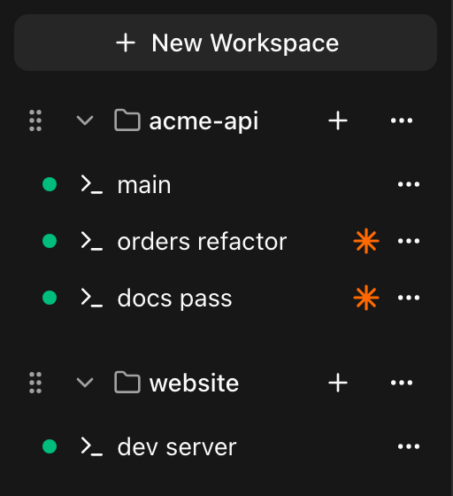
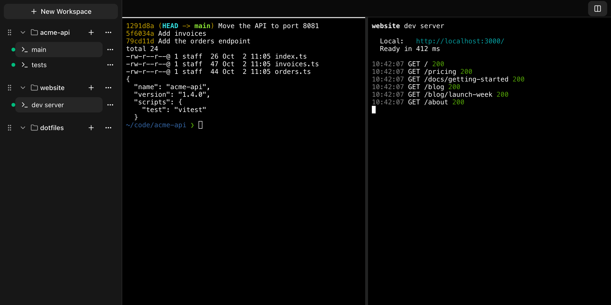
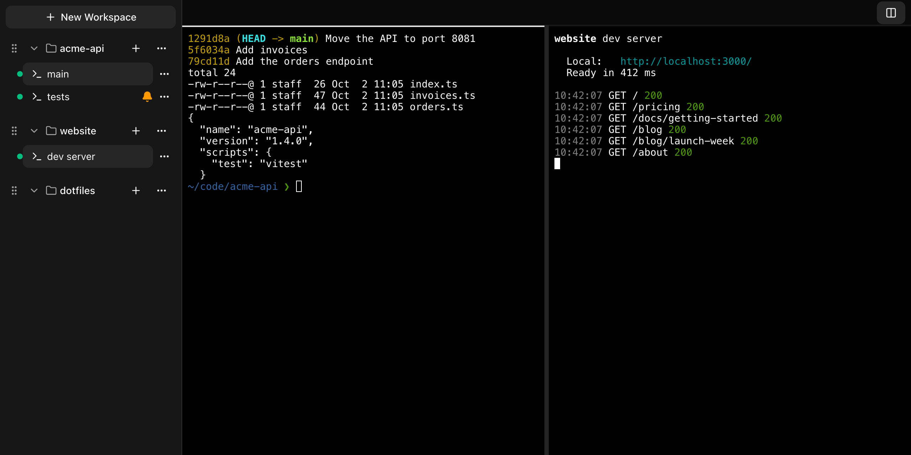
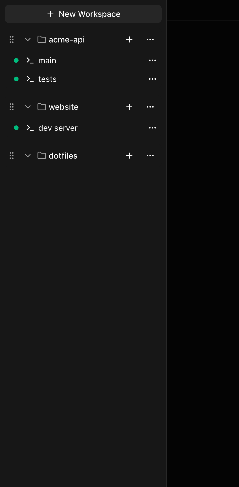
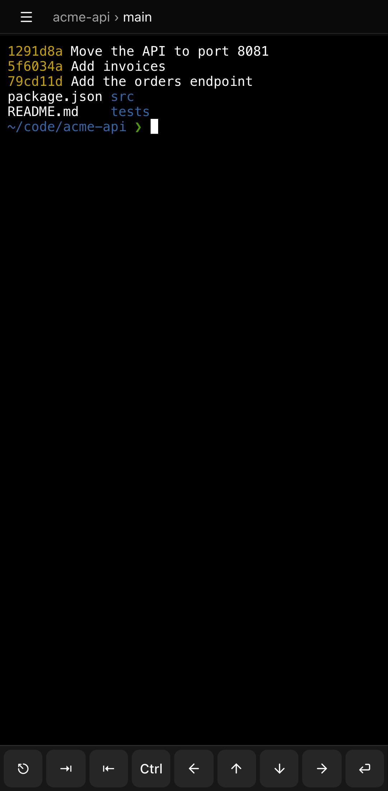

# Using k-bench

Open the URL that `k-bench install` printed. The sidebar lists your Workspaces and their Sessions, and the main area shows your Sessions' terminals.

## Workspaces and Sessions

A **Workspace** is a named entry that points at a project folder on your Mac. A **Session** is a named, persistent program inside a Workspace, started in that Workspace's folder: your shell, or, for a **Claude Session**, Claude Code itself.

**Create a Workspace.** Choose **New Workspace**, then paste the path of a project folder on your Mac or choose **Browse folders** to pick it. The name defaults to the folder's name; give it another one if you like. Several Workspaces may point at the same folder.

**Create a Session.** Choose the **+** next to a Workspace's name. It is a menu with two choices, and either way the new Session opens in the Focused Pane and starts in the Workspace's folder.

- **New shell** starts your login shell. It is called "session 1", "session 2" and so on.
- **New Claude…** opens a dialog where you choose a name (optional), the model, the effort, the advisor and Focus view, then launches a Claude Session. It runs Claude Code itself, and the sidebar marks it with a small orange glyph. A blank name gives "session N" too. [Using k-bench with Claude Code](claude-code.md) explains the dialog.

**Manage them.** Each row has a **...** menu.

- A Workspace's menu has **Rename**, **Change folder** and **Delete**. Deleting a Workspace ends its Sessions, and never touches the folder on disk. Drag a Workspace by its grip to reorder it (on a phone, press and hold first), and use the chevron to collapse it.
- A Session's menu has **Open in other pane**, **Rename**, **Delete** and, for a Stopped Session, **Restart**. Deleting a Session ends its program and everything running in it. Deleting a Claude Session leaves its Claude conversation alone.

A green dot next to a Session means its program is running. A hollow dot means it is Stopped.

**Sessions keep running.** A Session is a program running on your Mac, not a page in your browser. Close the tab, lock your phone, lose your connection, or restart k-bench to update it: the Session carries on, and your tabs reconnect on their own (a "reconnecting..." badge shows while they do). You can open the same Session on several devices at once. The terminal then takes the size of the device you used most recently.

Every open tab shows changes at once, so a Session you create on your phone appears on your laptop without a reload.

## Stopped Sessions: logging out and restarting

A Session is Stopped when its program no longer exists. That happens when the program exits (you type `exit` in a shell, or quit Claude Code in a Claude Session), and it happens when you log out of your Mac or restart it, because that ends every program in your login session.

After a logout or a restart, k-bench comes back on its own when you log in again. Everything is still listed: every Workspace and every Session. The Sessions show Stopped, and you restart each one yourself: open its **...** menu and choose **Restart**. The Session keeps its name and folder, and what it starts depends on its kind:

- A shell Session gets a fresh shell. What was running in the old shell is gone, so a dev server needs starting again, and so does a Claude Code you started by hand: bring that conversation back with Claude Code's own `/resume`.
- A Claude Session resumes its Claude conversation, with the same Launch options it was created with, and needs no `/resume`. See [Quitting, errors and restarting](claude-code.md#quitting-errors-and-restarting).

Two things to know:

- k-bench is a login item, so it starts when your user logs in to the Mac, not when the Mac boots to the login window. Until then nothing is reachable.
- The Mac has to be on and awake for you to reach it.

## Missing Workspaces

A Workspace is **Missing** when its folder no longer exists on your Mac, because you moved, renamed or deleted it. The sidebar shows a note under it: "Missing: its folder is gone from the Host, so Sessions can't start. Running Sessions carry on. Change the folder to fix it."

What that means in practice:

- Sessions that were already running in it keep running.
- Starting a new Session, or restarting a Stopped one (a Claude Session too), fails and the sidebar says "Folder does not exist".
- Every other Workspace and Session keeps working.

To fix it, open the Workspace's **...** menu, choose **Change folder** and point it at the folder's new location. If you put the folder back where it was, the Missing mark goes away by itself. If you no longer need the Workspace, delete it.

## Panes

On a wide screen the main area shows one or two **Panes**, side by side, each showing one Session.

- Turn the second Pane on and off with the **Two panes** button at the top right.
- A label at the top of each Pane's column, `Workspace › Session`, says which Session the Pane shows. A long one is cut off with `…` at about two thirds of the Pane's width. With two Panes the Focused Pane's label is bright and the other is dimmed. The browser tab is titled after the Focused Pane's Session, as `Session · Workspace — k-bench`.
- The **Focused Pane** is the one that opening a Session from the sidebar goes to, and the one that receives your keystrokes. With two Panes it has a bright line along its top edge. Click in a Pane to focus it, or press `⌘\` to move focus to the other one.
- Click a Session to open it in the Focused Pane. To open it in the other Pane, hold `⌘` while you click it, or use **Open in other pane** in its menu. If only one Pane is showing, this turns the second on.
- A Session can't be in both Panes. Opening one that is already in the other Pane swaps them.
- Drag the divider between the Panes to resize them. If you focus the divider you can also move it with the left and right arrow keys.

Your layout is remembered per browser, so your phone and your laptop can differ. A narrow screen always has a single Pane (see [the phone layout](#the-phone-layout)).

## Bells

A Session raises a **Bell** when the program in it rings the terminal bell, which any program does by printing the bell character. The Session's row in the sidebar then shows a bell icon, and a collapsed Workspace shows one too if any of its Sessions has a Bell. The Bell clears when you view that Session, which means opening it in a Pane.

To see one, create two Sessions. In the first, run `sleep 5; printf '\a'`, then open the second in the same Pane and wait: the first shows a Bell.

Things to know:

- A Bell is a mark in the sidebar. It makes no sound and sends no push notification, so it is for the moments you look at k-bench.
- A Session raises a Bell only while nothing is viewing it. A browser tab, on any device, that still has the Session open counts as viewing it. If Bells don't appear when you expect them, close the stale tab. See [Troubleshooting](troubleshooting.md#a-session-never-shows-a-bell).
- A Bell survives a k-bench restart. It is lost only if your Sessions are, which means after a logout or a Mac restart.

[Using k-bench with Claude Code](claude-code.md) shows how to make Claude Code ring the bell when it needs you.

## Scrolling, selecting and copying

The terminal's history is kept by tmux, up to 50,000 lines per Session, so it is there however you got back to the Session.

- **Scroll** with your mouse wheel or trackpad to move back through the history. Scroll back down to the bottom to return to the live screen (or press `q`). On a phone, drag with one finger, or flick to glide through the history quickly; flick again to go faster, and touch the screen to stop.
- **Select and copy** by dragging with the mouse. When you let go, the selected text is copied to your clipboard.
- If your browser doesn't let k-bench write to the clipboard, or you want the browser's own selection, hold **Shift** while you drag, then copy with `⌘C` as usual.
- On a phone there is touch scrolling and nothing for selecting text. Use a desktop browser when you need to copy from a Session.

## The phone layout

On a screen narrower than 768 pixels (a phone, or a narrow browser window), k-bench shows a single Pane that fills the screen.

- The **drawer** holds your Workspaces and Sessions. Open it with the menu button at the top left. Choosing a Session closes it and shows that Session. Tap outside it to close it without choosing.
- The **Pane** shows the Session you opened last, and its `Workspace › Session` label sits beside the menu button.

- The **extra keys** sit along the bottom while a Session is open. They are the keys a phone keyboard lacks, shown as symbols so they all fit in one row: **⎋** (Esc), **⇥** (Tab), **⇤** (Shift-Tab), **Ctrl**, the four arrow keys and **⏎** (Enter). Tapping one sends it to the Session as if you had typed it, and doesn't close your keyboard. On an iPhone the row ends with a tenth key, the **Smart typing** switch (see below).
- **Ctrl** is one-shot: tap it, then the next key you press, on the extra row or on your keyboard, is sent with Ctrl held. Ctrl then `c` is Ctrl-C. It un-arms after that one key.
- **Smart typing** (iPhone only) lets your keyboard's typing aids work in a Session: autocorrect, tapping a suggestion to swap a word, swipe typing, automatic spacing, double-space for a period and hold to delete. Your keyboard's changes reach the program as Backspaces followed by the new text, so Claude Code's `/` menu and your shell's Tab completion still work. In shell Sessions you get suggestions but no automatic word replacement or capitals (so `ls` stays `ls`); Claude Sessions get all of the keyboard's aids. Curly quotes, long dashes and non-breaking spaces reach the program as plain `'`, `"`, `--` and spaces. Pasting works as it always did.
- The **Smart typing switch**, the last key in the extra keys row, turns Smart typing on or off for the Session you are in. It is filled while Smart typing is on, which is how every new Session starts. Turn it off for a Session where you run a full-screen program such as vim or less, so the keyboard's edits are never sent to a program that would read them as commands; typing there is then exactly as it is without Smart typing. Each Session keeps its own choice on this phone (it survives a reload, and is forgotten when you delete the Session). The switch is only on the full row, so change it with the keyboard closed: it takes effect the next time the keyboard opens. Smart typing and its switch are not offered on desktop or Android.
- While your **on-screen keyboard is up**, k-bench fits into the space above it, so the line you're typing on stays visible. To make room, the menu button and the extra keys row are hidden, and a few of the extra keys float in the terminal's top-right corner instead: **Esc**, **Tab**, **Enter**, **Paste**, the four arrows and, in a row of its own at the right, **⌄** (close the keyboard). **Paste** pastes your clipboard's text into the Session, the way a paste on desktop does; on an iPhone the system may show a small "Paste" prompt first, which you tap to allow it; dismissing the prompt does nothing. It is only there where the browser lets a page read the clipboard. Close the keyboard with **⌄** to get the menu button and the full row back, including **Ctrl** and **⇤** (Shift-Tab). While the keyboard is up, the Session takes the smaller size, so another device viewing it sees it shrink too, until that device is used again.

Next: [Using k-bench with Claude Code](claude-code.md).
