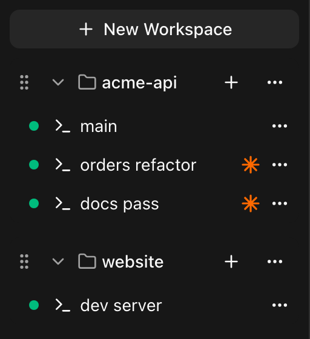
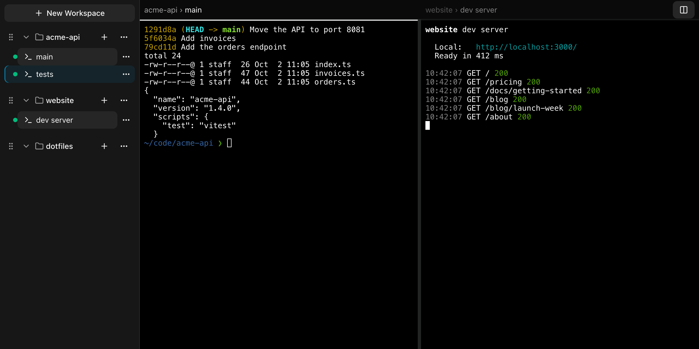
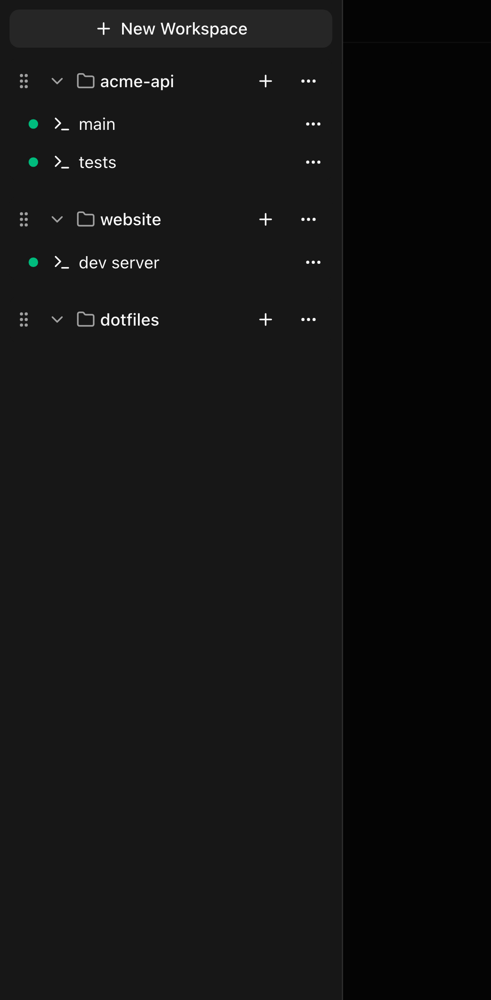

# Using k-bench

Open the URL that `k-bench install` printed. The sidebar lists your Workspaces and their Sessions, and the main area shows the Open Workspace: its Prime and, beside it, its Worker.

## Workspaces and Sessions

A **Workspace** is a named entry that points at a project folder on your Mac. A **Session** is a named, persistent program inside a Workspace, started in that Workspace's folder: your shell, or, for a **Claude Session**, Claude Code itself.

**Create a Workspace.** Choose **New Workspace** and pick a project folder on your Mac. The picker opens in the folder your newest Workspace is in (Home when you have none) and shows one folder's subfolders at a time: choose a subfolder to step into it, a breadcrumb above the list to step back up, or type in **Filter** to narrow a long list. **Places**, on the left (a row of chips on a phone), jumps to Home, to the folders that hold your Workspaces (the ones holding most first, up to five) or to Computer, the top of the disk. A folder that already has a Workspace shows that Workspace's name. The folder shown is the one you get. The name defaults to the folder's name, shown greyed in the **Name** box; type another one if you like. A folder has at most one Workspace, so a project never gets two sets of Claudes editing the same files: choosing Create on a folder that already has one says "A Workspace for this folder already exists", naming it, and takes you there instead, making it the Open Workspace. Changing a Workspace's folder to one that another Workspace has is refused with a message naming that Workspace, and the folder stays as it was. **Change folder** in a Workspace's menu uses the same picker, opening at the Workspace's own folder, and **Save** stays off until you pick a different one.

**Type or paste a path.** Click or tap the breadcrumb bar (anywhere past the last crumb) and it turns into a path field, like a file manager's address bar. `~` is Home. As you type, it suggests the folders inside the one you've typed so far; **Tab** completes the highlighted suggestion (the first, unless you pick another with the arrow keys), and tapping one does the same. **Enter** goes to the path you typed and turns the field back into breadcrumbs. It never makes anything: any part of the path that doesn't exist becomes new folders, just as if you'd made them with **New folder** below. Hidden folders (names starting with `.`) stay out of the list, but once you type a `.` the suggestions include them, greyed out. **Escape**, or clicking away, leaves the field without moving.

**Make a new folder for it.** For a new project, choose **New folder** in the picker and type its name; Enter steps into it, and another **New folder** there goes a level deeper. Folders that don't exist yet are shown in italics, in the breadcrumbs and in the path under the list, and the list inside one says it doesn't exist yet. Nothing is made on disk until you choose Create, whose button counts them ("Create 2 folders and Workspace"); tapping an earlier breadcrumb drops the new folders after it. A name that already exists just opens that folder. If a folder can't be made (a file is in the way, say), the message names it, no Workspace is created, and any folders already made stay. **Change folder** can make new folders the same way.

**Its Prime and Worker.** Every new Workspace comes with two Claude Sessions, the **Prime** and the **Worker**, made with it and lasting as long as it does. k-bench sets their Launch options: the Prime runs Opus at high effort with the advisor off, for planning, and the Worker runs Sonnet at high effort with an Opus advisor, for doing the work, both in Focus view. They're passed again on every launch. Both start out Stopped. **Opening the Workspace**, by clicking its name in the sidebar, starts them: the first start begins each one's Claude conversation, and opening it again later starts a Stopped one again, resuming its conversation. One that is already running is left alone. If you quit one (`/exit`) or it crashes, it stays Stopped until you open the Workspace again or choose **Restart** from its **...** menu; k-bench never restarts it by itself. A Missing Workspace starts nothing when opened, and its Prime and Worker start as soon as you change its folder to one that exists.

**The Open Workspace** is the one you last opened, on any device: k-bench keeps it on your Mac, so your phone and your laptop agree on it, and opening another on one device switches the others too. Loading k-bench opens it, so its Stopped Prime and Worker start when you arrive. Until you open one, it's the first Workspace in your order, and deleting it makes the first one open. The Prime and Worker are always called "Prime" and "Worker", so no other Session can take those names, and they can't be renamed or deleted.

**The sidebar** lists every Workspace in your order, each with a coloured tile of two letters from its name (the first letters of its first two words, or the first two letters of a one-word name), its colour worked out from the name. Only the Open Workspace is unfolded, showing its Prime, its Worker, a divider, then its other Sessions. Click another Workspace's name to open it. The header holds **New Workspace** (**+**) and the collapse button.

- Each Session has an icon: a crown for the Prime, a hammer for the Worker, a sparkle for another Claude Session and `>_` for a shell.
- The Sessions on screen, in a Pane, are highlighted.
- A Stopped Session is dimmed and labelled "stopped".
- A Session with a [Bell](#bells) shows a bell icon. A Workspace that isn't open shows an amber dot on its tile when any of its Sessions has a Bell.
- A [Missing](#missing-workspaces) Workspace has a warning mark on its tile.

**Collapse the sidebar** with the button at the right of its header, to give the Panes the room. It becomes a narrow column of Workspace tiles, with the Open Workspace's Sessions as small icons under its tile: the same icons as the tree, dimmed when Stopped, with an amber dot when one has a Bell. Click a tile to open that Workspace, or an icon to open that Session. A Workspace that isn't open still shows its amber dot. **New Workspace** (**+**) is at the bottom of the column, and the button at the top expands the sidebar again. Collapsed or expanded is remembered on this device, so your laptop and your iPad can each keep their own; a phone's drawer is always the full tree.

**Create a Session.** Choose the **+** next to the Open Workspace's name. It is a menu with two choices, and either way the new Session opens in the right Pane and starts in the Workspace's folder.

- **New shell** starts your login shell. It is called "session 1", "session 2" and so on.
- **New Claude…** opens a dialog where you choose a name (optional), the model, the effort, the advisor and Focus view, then launches a Claude Session. It runs Claude Code itself, and the sidebar marks it with a sparkle. A blank name gives "session N" too. [Using k-bench with Claude Code](claude-code.md) explains the dialog.

**Manage them** from the **...** menus in the sidebar.

- The Open Workspace's row has one, with **Rename**, **Change folder** and **Delete**; open a Workspace to manage it. Deleting a Workspace ends its Sessions, and never touches the folder on disk. Drag a Workspace's row to reorder it (on a phone, press and hold first); a short click still opens it.
- An Other Session's menu has **Rename**, **Delete** and, when it's Stopped, **Restart**. Deleting a Session ends its program and everything running in it. Deleting a Claude Session leaves its Claude conversation alone.
- The Prime and Worker can't be renamed or deleted, so they have a menu only while Stopped, offering **Restart**.

**Sessions keep running.** A Session is a program running on your Mac, not a page in your browser. Close the tab, lock your phone, lose your connection, or restart k-bench to update it: the Session carries on, and your tabs reconnect on their own (a "reconnecting..." badge shows while they do). You can open the same Session on several devices at once. The terminal then takes the size of the device you used most recently.

Every open tab shows changes at once, so a Session you create on your phone appears on your laptop without a reload.

## Stopped Sessions: logging out and restarting

A Session is Stopped when its program no longer exists. That happens when the program exits (you type `exit` in a shell, or quit Claude Code in a Claude Session), and it happens when you log out of your Mac or restart it, because that ends every program in your login session.

After a logout or a restart, k-bench comes back on its own when you log in again. Everything is still listed: every Workspace and every Session. The Sessions show Stopped, and you restart each one yourself: open its **...** menu and choose **Restart**, or, when it's in a Pane, press the **Restart** button that Pane shows in place of its terminal. Opening the Workspace restarts its Prime and Worker for you. The Session keeps its name and folder, and what it starts depends on its kind:

- A shell Session gets a fresh shell. What was running in the old shell is gone, so a dev server needs starting again, and so does a Claude Code you started by hand: bring that conversation back with Claude Code's own `/resume`.
- A Claude Session resumes its Claude conversation, with the same Launch options it was created with, and needs no `/resume`. See [Quitting, errors and restarting](claude-code.md#quitting-errors-and-restarting).

Two things to know:

- k-bench is a login item, so it starts when your user logs in to the Mac, not when the Mac boots to the login window. Until then nothing is reachable.
- The Mac has to be on and awake for you to reach it.

## Missing Workspaces

A Workspace is **Missing** when its folder no longer exists on your Mac, because you moved, renamed or deleted it. Its tile in the sidebar shows a warning mark, and while it's the Open Workspace a note under its name says "Missing: its folder is gone, so Sessions can't start. Running ones carry on." with a **Change folder** button.

What that means in practice:

- Sessions that were already running in it keep running.
- Starting a new Session, or restarting a Stopped one (a Claude Session too), fails and the sidebar says "Folder does not exist".
- Every other Workspace and Session keeps working.

A Pane whose Session isn't running says "This Workspace's folder is missing" instead of offering **Restart**, with a **Change folder** button, so you can fix it from there too.

To fix it, open the Workspace and choose **Change folder**, in the note under its name, in its **...** menu or in a Pane, and point it at the folder's new location. If you put the folder back where it was, the Missing mark goes away by itself. If you no longer need the Workspace, delete it.

## Panes

On a desktop or tablet (768 pixels wide and up) the main area belongs to the **Open Workspace** and shows two **Panes** side by side.

- The **left Pane** always shows the Workspace's Prime, under a slim label reading "Prime".
- The **right Pane** shows its Worker, or another of its Sessions that you opened there. Its slim **tab bar** has the **Worker** first, then a tab for each Other Session you opened there.
- Click an Other Session in the sidebar (or create one) to show it in the right Pane. It gets a tab if it has none yet. Click a tab, or the Worker in the sidebar, to switch. Clicking the Prime puts your keystrokes in the left Pane.
- The **×** on a tab removes only the tab: the Session keeps running, and you can open it again from the sidebar. Closing the tab that's showing brings back the Worker, which has no ×. Deleting a Session removes its tab.
- A tab shows an amber dot when its Session rings the [Bell](#bells) while it's hidden.
- Clicking the Workspace's name brings back Prime with Worker, and keeps the tabs.
- The tabs, and which one is showing, are kept for each Workspace on your Mac, so switching Workspaces, reloading, or picking up another device brings back what you had.
- The top bar shows the Workspace's name, with its folder as a tooltip, and the browser tab reads `Workspace — k-bench`.
- Sessions on screen are highlighted in the sidebar. Only those have a terminal open, so any other Session can raise a [Bell](#bells).
- Drag the divider between the Panes to resize them, anywhere you like. Double-click it for half and half. If you focus the divider you can also move it with the left and right arrow keys.

### Shutting a Pane

When the screen is tight, give one Claude the whole width by shutting the other Pane: drag the divider to within a few percent of an edge.

- A shut Pane leaves a thin **rail** with its Session's icon and name, written vertically. Its terminal is closed, so its Session can raise a [Bell](#bells), which shows as an amber dot on the rail.
- Click the rail to open the Pane again where the divider was before you shut it (half and half if you never moved it).
- Opening something into a shut Pane opens it too: clicking the Prime reopens the left Pane, and clicking the Workspace's name, the Worker or an Other Session reopens the right one.
- Where the divider sits, and which Pane is shut, are kept for each Workspace on this device only, so a laptop and an iPad can each be set up their own way. They survive a reload.

A narrow screen shows one Session at a time instead (see [the phone layout](#the-phone-layout)).

## Bells

A Session raises a **Bell** when the program in it rings the terminal bell, which any program does by printing the bell character. The Session's row in the sidebar then shows a bell icon, and a Workspace that isn't open shows an amber dot on its tile if any of its Sessions has a Bell. The Bell clears when you view that Session, which means opening it in a Pane.

To see one, create two Sessions. In the first, run `sleep 5; printf '\a'`, then open the second in the same Pane and wait: the first shows a Bell.

Things to know:

- A Bell is a mark in the sidebar. It makes no sound and sends no push notification, so it is for the moments you look at k-bench.
- A Session raises a Bell only while nothing is viewing it. A browser tab, on any device, that still has the Session open counts as viewing it. If Bells don't appear when you expect them, close the stale tab. See [Troubleshooting](troubleshooting.md#a-session-never-shows-a-bell).
- A Bell survives a k-bench restart. It is lost only if your Sessions are, which means after a logout or a Mac restart.

[Using k-bench with Claude Code](claude-code.md) shows how to make Claude Code ring the bell when it needs you.

## Scrolling, selecting and copying

The terminal's history is kept by tmux, up to 50,000 lines per Session, so it is there however you got back to the Session.

- **Scroll** with your mouse wheel or trackpad to move back through the history. Scroll back down to the bottom to return to the live screen (or press `q`). On a phone, drag with one finger, or flick to glide through the history quickly; flick again to go faster, and touch the screen to stop.
- **Select and copy** by dragging with the mouse. When you let go, the selected text is copied to your clipboard.
- If your browser doesn't let k-bench write to the clipboard, or you want the browser's own selection, hold **Shift** while you drag, then copy with `⌘C` as usual.
- On a phone there is touch scrolling and nothing for selecting text. Use a desktop browser when you need to copy from a Session.

## The phone layout

On a screen narrower than 768 pixels (a phone, or a narrow browser window), k-bench shows one Session of the [Open Workspace](#workspaces-and-sessions) at a time, filling the screen. Like any device, loading k-bench on your phone opens the Open Workspace, which starts its Prime and Worker.

- The **top bar** is the menu button and a `Workspace › Session ▾` title naming what's on screen, and nothing else. When the title doesn't fit, the Workspace's name is cut off first, so the Session's name always shows in full.
- **Tap the title** to switch Sessions without the drawer. A sheet rises from the bottom listing the Open Workspace's Sessions: the Prime, the Worker, a divider, then the other Sessions in your order, each with its icon, "stopped" when it is, and an amber dot when it has a Bell. The Session on screen is highlighted. Tap one to show it, or tap outside the sheet to close it. New Sessions come from the drawer, not the sheet.
- **Bell dots** in the top bar tell you who wants you. A dot on the title's Workspace name means another Session of this Workspace has a Bell (the Worker, say, while you're looking at the Prime); a dot on the menu button means a Session in another Workspace has one. Both can show at once, and the Session on screen never counts.
- The **drawer** holds [the sidebar tree](#workspaces-and-sessions), always unfolded and with taller rows for touch. Open it with the menu button at the top left. Tap a Workspace's name to open it on its Prime, or tap a Session of the Open Workspace to show it; either closes the drawer. Tap outside it to close it without choosing. New Sessions come from the Open Workspace's **+** in the drawer, and **Rename**, **Change folder** and **Delete** from its **...**.
- Your phone **remembers the Session it was showing** in each Workspace, on this phone only, so coming back (or reloading) puts you where you were. It is kept apart from the right Pane on your desktop, so the two never fight. A Workspace you haven't shown anything in yet, or whose remembered Session was deleted, shows its Prime.
- A **Stopped** Session on screen shows a **Restart** button in place of the terminal. In a [Missing](#missing-workspaces) Workspace it says the folder is missing instead, with a **Change folder** button that fixes it from there.
- Only the Session on screen has a terminal open, so every other Session can raise a [Bell](#bells).

- The **extra keys** sit along the bottom while a Session is open. They are the keys a phone keyboard lacks, shown as symbols so they all fit in one row: **⎋** (Esc), **⇥** (Tab), **⇤** (Shift-Tab), **Ctrl**, the four arrow keys and **⏎** (Enter). Tapping one sends it to the Session as if you had typed it, and doesn't close your keyboard. On an iPhone the row ends with a tenth key, the **Smart typing** switch (see below).
- **Ctrl** is one-shot: tap it, then the next key you press, on the extra row or on your keyboard, is sent with Ctrl held. Ctrl then `c` is Ctrl-C. It un-arms after that one key.
- **Smart typing** (iPhone only) lets your keyboard's typing aids work in a Session: autocorrect, tapping a suggestion to swap a word, swipe typing, automatic spacing, double-space for a period and hold to delete. Your keyboard's changes reach the program as Backspaces followed by the new text, so Claude Code's `/` menu and your shell's Tab completion still work. In shell Sessions you get suggestions but no automatic word replacement or capitals (so `ls` stays `ls`); Claude Sessions get all of the keyboard's aids. Curly quotes, long dashes and non-breaking spaces reach the program as plain `'`, `"`, `--` and spaces. Pasting works as it always did.
- The **Smart typing switch**, the last key in the extra keys row, turns Smart typing on or off for the Session you are in. It is filled while Smart typing is on, which is how every new Session starts. Turn it off for a Session where you run a full-screen program such as vim or less, so the keyboard's edits are never sent to a program that would read them as commands; typing there is then exactly as it is without Smart typing. Each Session keeps its own choice on this phone (it survives a reload, and is forgotten when you delete the Session). The switch is only on the full row, so change it with the keyboard closed: it takes effect the next time the keyboard opens. Smart typing and its switch are not offered on desktop or Android.
- While your **on-screen keyboard is up**, k-bench fits into the space above it, so the line you're typing on stays visible. To make room, the top bar and the extra keys row are hidden, and a few of the extra keys float in the terminal's top-right corner instead: **Esc**, **Tab**, **Enter**, **Paste**, the four arrows and, in a row of its own at the right, **⌄** (close the keyboard). **Paste** pastes your clipboard's text into the Session, the way a paste on desktop does; on an iPhone the system may show a small "Paste" prompt first, which you tap to allow it; dismissing the prompt does nothing. It is only there where the browser lets a page read the clipboard. Close the keyboard with **⌄** to get the top bar and the full row back, including **Ctrl** and **⇤** (Shift-Tab). While the keyboard is up, the Session takes the smaller size, so another device viewing it sees it shrink too, until that device is used again.

Next: [Using k-bench with Claude Code](claude-code.md).
